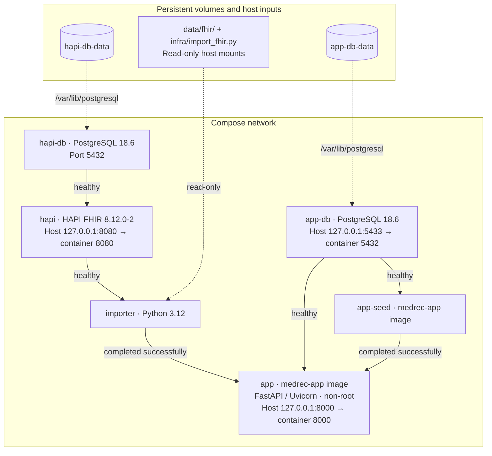

# Medication List Reconciliation

Compare synthetic FHIR, pharmacy and patient-reported medication lists to find
duplicates, missing medications and dosage differences. View saved runs and
export findings to PDF. Findings support review; they never recommend treatment.

## Prerequisites

- Git and Docker with Compose v2.20 or newer.
- Enough memory for HAPI's 2 GiB container limit, two PostgreSQL databases and the app.
- Ports 8000, 8080 and 5433 available.

## Run locally

From the repository root, copy the example configuration once and start the app:

```sh
cp .env.example .env
docker compose up -d --build --wait --wait-timeout 300
```

Open http://127.0.0.1:8000. Startup loads the synthetic patients and medication data.
The example configuration contains public demo passwords; keep local changes in
`.env`, which is ignored by Git.

## Use the app

Search for `Mixton` or `Cleary`, open a patient and review the three medication
lists. Click **Run** to see findings, open saved runs in **History**, or download
a PDF report. The [demo patient guide](docs/DEMO_PATIENTS.md) describes more examples.

## Stop the app

```sh
docker compose down
```

Saved data remains in the database volumes.

## Release

After the changes are reviewed, merged and tests pass, update the version in
`pyproject.toml`, refresh `uv.lock`, and add the CHANGELOG entry. With Bash, uv
and Python 3.12 installed, build from an annotated tag:

```sh
git switch main
git pull --ff-only
git tag -a v1.0.0 -m "MedRec 1.0.0"
scripts/build_release.sh 1.0.0
export COMPOSE_FILE=compose.release.yaml
export APP_VERSION=1.0.0
docker compose up -d --no-build --wait --wait-timeout 300
curl --fail http://127.0.0.1:8000/healthz
```

Recorded health-check output from the local 1.0.0 run:

```json
{"status":"ok","version":"1.0.0"}
```

Verify startup and backup before publishing the tag with
`git push origin v1.0.0`. Use the same steps for future versions. See
[publishing a release](docs/RELEASING.md) for the full procedure.

## Back up and restore

The app uses PostgreSQL. Run the backup with the same Compose configuration as
the running app:

```sh
scripts/backup.sh
```

The script pauses app writes, restores into `medrec_restore_check`, compares
table counts, removes that scratch database, and resumes the app if it was
running. A recorded output excerpt after three example reconciliations:

```text
RESTORE VERIFIED: medrec_restore_check
public.finding=9
public.intake_interview=12
public.intake_medication=47
public.medication_record=27
public.patient=12
public.reconciliation_run=3
public.rejected_record=6
```

Verified archives are saved under the gitignored `backups/` directory. To
restore one, set `BACKUP` to its path. This replaces the app database and loses
changes made after that backup. The commands stop on an error and leave the
app stopped if recovery fails:

```sh
BACKUP="backups/your-archive.dump"
(
  set -e
  test -s "$BACKUP"
  docker compose stop app
  docker compose exec -T app-db sh -eu -c 'dropdb -U "$POSTGRES_USER" "$POSTGRES_DB" && createdb -U "$POSTGRES_USER" -T template0 "$POSTGRES_DB"'
  docker compose exec -T app-db sh -eu -c 'pg_restore -U "$POSTGRES_USER" -d "$POSTGRES_DB" --no-owner --exit-on-error --single-transaction' < "$BACKUP"
  docker compose exec -T app-db sh -eu -c 'psql -X -U "$POSTGRES_USER" -d "$POSTGRES_DB" -v ON_ERROR_STOP=1 -c ANALYZE'
  docker compose start app
)
```

The database maintenance command printed `ANALYZE` during the local restore;
a subsequent `scripts/backup.sh` verified the same counts shown above. These
backups cover app history and intake; HAPI data is re-imported from the committed
synthetic bundles.

## Upgrade and roll back

Once both 1.0.0 and 1.1.0 images have been built from their tags:

```sh
export COMPOSE_FILE=compose.release.yaml
scripts/backup.sh
APP_VERSION=1.1.0 docker compose up -d --no-build --no-deps --wait app
# Create a run, then back up the newer history before rolling back.
scripts/backup.sh
APP_VERSION=1.0.0 docker compose up -d --no-build --no-deps --wait app
curl --fail http://127.0.0.1:8000/healthz
```

Confirm the version is 1.0.0, open History to check that newer runs remain, and
create another reconciliation. Unknown finding types display as `Other (<value>)`.
Rollback changes only the app image on the existing database volume; restoring
an older backup would discard newer history. The two-version demonstration
requires the 1.1.0 release and has not yet been run.

## Medication record shape

A clean medication record contains the stable patient identifier, source and
source record ID, original name, dose per administration, frequency and date.
For example:

```json
{
  "patient_id": "CASE-CLEAN",
  "source": "pharmacy",
  "source_record_id": "PH-EXAMPLE",
  "name": "Zestril",
  "dose_amount": "10",
  "dose_unit": "mg",
  "frequency": "once daily",
  "date_recorded": "2026-10-28",
  "normalized_name": "lisinopril",
  "rxcui": null,
  "raw": {}
}
```

`source` is `fhir`, `pharmacy` or `intake`. Dose must be positive; accepted units
are `mg`, `g`, `mcg` and `mL`. Dates use `YYYY-MM-DD` and cannot be in the future.
Frequency, normalized name and RxNorm code may be absent; `raw` preserves the
source fields. Version 1.0.0 stores frequency without comparing it.

## Alias configuration

`data/aliases.json` maps normalized names to a common medication name. A minimal
example of its format:

```json
{
  "version": 1,
  "aliases": {"zestril": "lisinopril", "lipitor": "atorvastatin"},
  "ignore_tokens": ["oral", "tablet"]
}
```

Keys, values and ignored tokens must be lowercase, trimmed and non-empty.
Alias chains are rejected. Name normalization removes strengths, bracketed
brand tags and ignored words before looking up an alias. Missing or malformed
configuration prevents the app from starting.

## Architecture

All six services share the Compose network. Solid arrows below show startup
gates, pointing from a prerequisite to the service that waits for it. Dashed
arrows show data mounts.



## Documentation

- [Architecture and API](docs/ARCHITECTURE.md)
- [Testing](docs/TEST_CHECKLIST.md)
- [Release images, backups and rollback](docs/OPERATIONS.md)
- [Publishing a release](docs/RELEASING.md)
- [Changelog](CHANGELOG.md)
