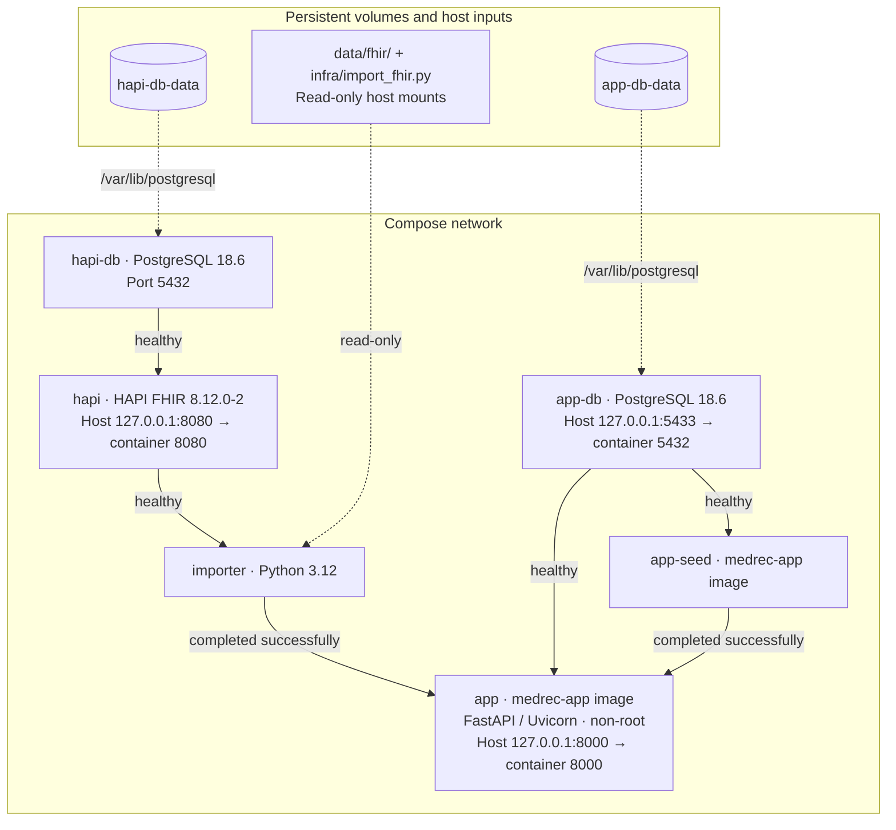

# Medication List Reconciliation

Compare synthetic FHIR, pharmacy and patient-reported medication lists to find
duplicates, missing medications and dosage differences. View saved runs and
export findings to PDF. Findings support review; they never recommend treatment.

## Prerequisites

- Git and Docker with Compose v2.20 or newer.
- Enough memory for HAPI's 2 GiB container limit, two PostgreSQL databases and the app.
- Ports 8000, 8080 and 5433 available.

## Run locally

From the repository root, copy the example configuration once and start the app:

```sh
cp .env.example .env
docker compose up -d --build --wait --wait-timeout 300
```

Open http://127.0.0.1:8000. Startup loads the synthetic patients and medication data.
The example configuration contains public demo passwords; keep local changes in
`.env`, which is ignored by Git.

## Use the app

Search for `Mixton` or `Cleary`, open a patient and review the three medication
lists. Click **Run** to see findings, open saved runs in **History**, or download
a PDF report. The [demo patient guide](docs/DEMO_PATIENTS.md) describes more examples.

## Stop the app

```sh
docker compose down
```

Saved data remains in the database volumes.

## Architecture

All six services share the Compose network. Solid arrows below show startup
gates, pointing from a prerequisite to the service that waits for it. Dashed
arrows show data mounts.



## Documentation

- [Architecture and API](docs/ARCHITECTURE.md)
- [Testing](docs/TEST_CHECKLIST.md)
- [Release images, backups and rollback](docs/OPERATIONS.md)
- [Publishing a release](docs/RELEASING.md)
- [Changelog](CHANGELOG.md)
