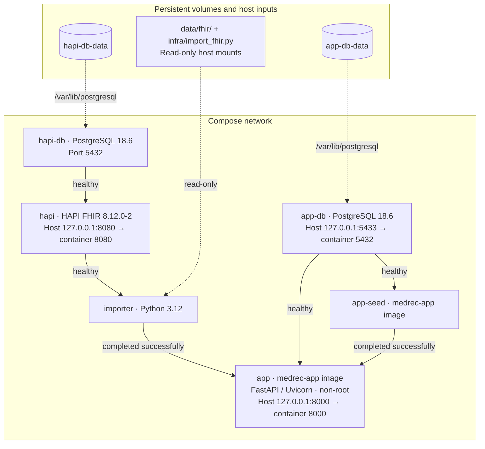

# Architecture

All six services share the Compose network. Solid arrows below show startup
gates, pointing from a prerequisite to the service that waits for it. Dashed
arrows show data mounts.

HAPI stores FHIR resources in `hapi-db`; the importer writes bundles through
`http://hapi:8080/fhir`. The seeder writes intake records to `app-db`. The app
receives `FHIR_BASE_URL=http://hapi:8080/fhir` and a `DATABASE_URL` pointing to
`app-db:5432`.

`app` and `app-seed` use the same image built from `infra/Dockerfile`. App code,
aliases, pharmacy data, and intake CSVs are baked into that image. Passwords
come from the gitignored `.env`; `infra/hapi.env` holds non-secret HAPI settings.
Both database volumes survive `docker compose down`; `down -v` deletes them.

## HTTP API

- `POST /api/patients/{fhir_id}/reconcile` creates a reconciliation run.
- `GET /api/runs/{run_id}` retrieves a stored run as JSON.
- `GET /runs/{run_id}/report.pdf` downloads its PDF report.
- `GET /healthz` returns the app status and version.

Use patient IDs returned by the current HAPI server. Saved runs retain source
snapshots and stable identifiers so history remains readable after re-import.
