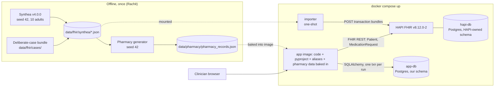
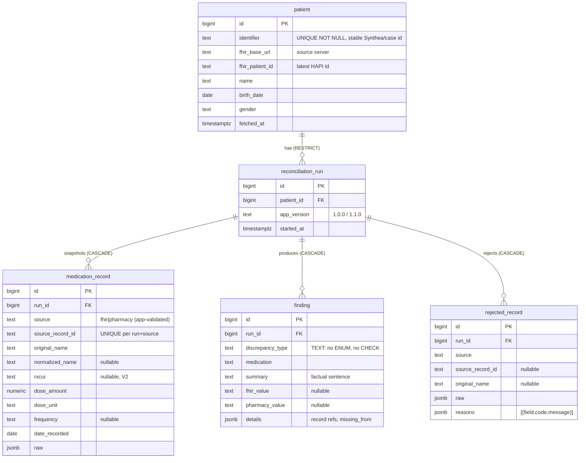
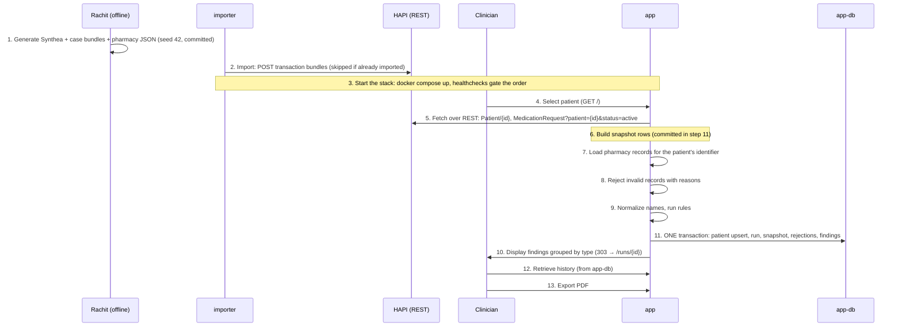

# MedRec: Technical Plan (V1 1.0.0, V2 1.1.0)

Team 1, Week 3. A web app for clinicians that compares a patient's medications from a HAPI FHIR server (REST only) against synthetic pharmacy records. It flags discrepancies, groups them by type, saves each reconciliation, and exports a PDF.

> **Safety:** synthetic data only. The app **reports discrepancies and never recommends** treatment, dose changes or discontinuation. The UI and the PDF both show this disclaimer: *"Synthetic data. Reports discrepancies between sources for clinician review; does not recommend treatment."*

Sources for each decision: `docs/research/NN-*.md` (cited as [R01]…[R11]). Decisions with no research behind them, and their owners, are in `docs/ASSUMPTIONS.md`. Tickets are in `docs/BACKLOG.md` (B1–B17). This plan has been through a red-team review, and its findings are folded in.

---

## 1. What is realistic by Fri 10/30

| Item | Likelihood | Why |
|---|---|---|
| V1 1.0.0 (every Definition-of-Done item) | **High**, target Thu 19:45 | HAPI + Postgres smoke-tested (16 s start); stack pinned; 5 parallel streams with disjoint files |
| V2 frequency mismatch | Medium-high | One rule file, built in parallel with V1 integration from ~16:30; merges after the v1.0.0 tag |
| V2 RxNorm normalization | Medium | The offline cache is the main work; live lookup is optional |
| Rollback demo 1.1.0 → 1.0.0 | High once 1.1.0 exists | Image swap on the same volume. V2 adds no DDL. |
| Presentation page and checklist | High | Docs only |

**Schedule (EDT):**

| Time (Thu) | Work |
|---|---|
| on approval (~11:15) | Phase 3 foundation, B1 due **12:45** |
| 12:45–17:00 | Phase 4 parallel build |
| 16:30– | V2 branches start from the merged rules (B15, B16) |
| 17:00–19:00 | Phase 5 integration and clean-stack verification |
| 19:45 | **v1.0.0** |
| 21:30 | V2 merges |
| 22:00 | **v1.1.0** |
| 22:30 | Rollback demo recorded |
| 23:59 | Presentation content complete |

Friday morning, before the presentation: dry run (runbook item).

**Scope-cut ladder** (cut from the top; each cut is reported to the lead with the rubric items it affects):
1. RxNorm live lookup → committed cache only. No rubric impact.
2. HTMX partial swaps → plain forms with full-page reloads. No rubric impact.
3. JSON API → keep only `POST /api/patients/{id}/reconcile` and `GET /api/runs/{id}`. Already the minimum. No rubric impact.
4. pre-commit hook → ruff runs in CI only. No rubric impact.
5. RxNorm normalization slips out of 1.1.0 → affects "V2: two additions" (1.1.0 = frequency rule only).
6. If v1.0.0 isn't tagged by 21:00 → **1.1.0 = frequency rule only**, kept so the rollback demo still happens.

**Never cut:** the transaction and rollback test, validation, CI, the 3 V1 rules, the PDF (including the no-discrepancy case), research docs, the presentation page, the rollback demo.

---

## 2. Final stack (pinned)

| Concern | Choice | Version | Source |
|---|---|---|---|
| Language | Python | 3.12 (image `python:3.12.16-slim-trixie`) | R04, R08 |
| Web | FastAPI + Uvicorn, sync `def` routes | fastapi 0.162.0, uvicorn 0.54.0 | R04 |
| UI | Jinja2 server-rendered (autoescape on) + vendored HTMX, no JS build | jinja2 3.1.6, python-multipart 0.0.32, htmx 2.0.11 | R04 |
| Contract / validation | pydantic v2 | 2.14.1 | R04 |
| ORM / driver | SQLAlchemy 2.0 + psycopg 3 (`postgresql+psycopg://`) | sqlalchemy 2.0.55, psycopg[binary] 3.3.6 (2.1.6 as fallback) | R04, R05 |
| FHIR client | httpx, sync, plain dicts, injectable transport, ~30-line pager | httpx 0.28.1 | R04 |
| PDF | fpdf2 with **bundled DejaVu Sans regular + bold TTF**, so µ, em dash and curly quotes render | fpdf2 2.8.9 | R06 (tested in python:3.12-slim) |
| Databases | PostgreSQL, one image for both DBs; volume at `/var/lib/postgresql` (PG 18 layout); healthcheck `pg_isready -h 127.0.0.1 -U … -d …` | `postgres:18.6-alpine` | smoke test 2026-10-29, R05 (R08 preferred 16; 18.6 kept because HAPI was verified on it) |
| FHIR server | HAPI FHIR JPA starter, distroless; healthcheck `java -cp /app HealthCheck` | `hapiproject/hapi:v8.12.0-2` | R02, R08, smoke test |
| Synthetic EHR | Synthea, run once in Docker; output committed | v4.0.0 jar on `eclipse-temurin:17.0.20_8-jdk-jammy` | R01 |
| Terminology (V2) | RxNav REST + committed cache `data/rxnorm_cache.json` | RxNorm 05-Oct-2026, API 3.1.356 | R07 |
| Deps | `pyproject.toml` + `uv.lock` (`uv sync --locked`); version read from `pyproject.toml` via `tomllib` | uv ≥0.12 | R04 |
| Tests / lint | pytest, ruff, pypdf (dev) | pytest 9.2.0, ruff 0.17.3, pypdf 6.21.4 | R06, R09 |
| CI | GitHub Actions on `ubuntu-24.04` | checkout@v7, setup-python@v7, setup-uv@v10.3.3 | R09 |

Pins are exact, and nothing gets upgraded before Friday (FastAPI shipped breaking releases on Oct 21–23 [R04]). B1 must prove the set resolves (`uv lock`) and that a TestClient `/healthz` smoke test passes with httpx 0.28.1. Starlette's deprecation warning about plain httpx is filtered in the pytest config.

---

## 3. Architecture



**Fixed rules:**
- The app never connects to `hapi-db`; it gets no credentials for it.
- The app DB holds a per-run **snapshot** with the original FHIR resource IDs. It is not a replica, and nothing syncs.
- Nothing from the out-of-scope list is added.
- App data files (aliases, pharmacy dataset, V2 RxNorm cache) are **baked into the app image**, not mounted. That way `medrec-app:1.0.0` always runs with 1.0.0 data during a rollback.

---

## 4. Shared medication record contract (`contract/`; single source of truth)

Used by: the pharmacy generator, FHIR mapping, validation, DB rows, rules and tests. It is implemented first (B1) and **frozen** after merge; changing it needs a PR approved by all four.

### 4.1 Types
| `MedicationRecord` field | Type | Req. | Rule |
|---|---|---|---|
| `patient_id` | str | yes | Stable patient key: the value of `Patient.identifier` with system `https://github.com/synthetichealth/synthea`, or `urn:medrec:case` for deliberate cases. **Not** the HAPI id, which changes on re-import [R01, R03]. |
| `source` | `"fhir" \| "pharmacy"` | yes | |
| `source_record_id` | str | yes | FHIR `MedicationRequest.id` (HAPI-assigned), or pharmacy `record_id` |
| `name` | str | yes | Original name, verbatim (e.g. `lisinopril 10 MG Oral Tablet`, `Zestril`) |
| `dose_amount` | Decimal > 0 | yes | **Per administration** on both sides. FHIR: strength parsed from the RxNorm display × the unitless `doseQuantity.value` (default 1) [R03]. Pharmacy: as dispensed per dose. |
| `dose_unit` | `"mg" \| "g" \| "mcg" \| "mL"` | yes | Input spellings normalize as `MG→mg`, `ug/µg/μg/mcg→mcg`, `G→g`, `ml/ML→mL`. Anything else is rejected. |
| `frequency` | str \| None | no | The source's frequency **as given**, trimmed. FHIR: `timing.code`, else `"{frequency}/{period}{periodUnit}"`, plus ` PRN` if `asNeededBoolean`, else `dosageInstruction.text`. **V1 stores and displays it verbatim and never compares it.** |
| `date_recorded` | date | yes | Pharmacy `date_recorded`, FHIR `authoredOn`. ISO date, not in the future. |
| `normalized_name` | str \| None | no | Identity key. V1: alias-normalized (§4.3). V2: may become the RxNorm ingredient name. |
| `rxcui` | str \| None | no | **V2 only.** Sorted ingredient RxCUIs, comma-joined |
| `raw` | dict | no (default `{}`) | Original FHIR resource or pharmacy row, for traceability. Never used by rules. |

Other contract types:
- `Reason(field, code, message)`.
- `Rejection(source, source_record_id | None, name | None, normalized_name | None, raw, reasons: list[Reason])`. The name is kept when readable so rules can tell "rejected" from "absent".
- `Finding(discrepancy_type: str, medication: str, summary: str, fhir_value: str | None, pharmacy_value: str | None, details: dict)`.
- `ReconciliationInput(fhir: list[MedicationRecord], pharmacy: list[MedicationRecord], rejected: list[Rejection])`.

### 4.2 Units
- Accepted units: `mg, g, mcg, mL`.
- Comparison converts to base units with `Decimal`: `g → mg ×1000`, `mcg → mg ÷1000`, `mL` stays `mL`. So **500 mg == 0.5 g**.
- Mass vs volume never compares equal: that is a dosage mismatch with the summary "different measure".
- The Synthea side never produces mL; mL is covered by unit tests and the case bundle.

### 4.3 Identity matching (V1)
`normalized_name = aliases.get(key, key)`, where `key` is built from the name:
1. Lowercase.
2. Drop bracketed brand tags (`[Lipitor]`).
3. Strip strength and quantity tokens (`\d+(\.\d+)?\s*(mg|mcg|ug|g|ml|hr|actuat)\b`).
4. Split on anything that isn't a letter or digit.
5. Drop `ignore_tokens` and bare numbers.
6. Join with single spaces.

Examples:
- `24 HR Metformin hydrochloride 500 MG Extended Release Oral Tablet` → `metformin hydrochloride` → `metformin`
- `atorvastatin 20 MG Oral Tablet [Lipitor]` → `atorvastatin`
- `Zestril` → `lisinopril`

V1 identity is name-level. The dosage rule catches strength differences. Form and route are not part of V1 identity, a documented limitation that V2 tightens (§7.2).

### 4.4 Alias config (`data/aliases.json`; schema `contract.aliases.AliasConfig`)
```json
{
  "version": 1,
  "aliases": { "zestril": "lisinopril", "lipitor": "atorvastatin", "metformin hydrochloride": "metformin", "norvasc": "amlodipine" },
  "ignore_tokens": ["oral", "tablet", "tab", "capsule", "cap", "extended", "release", "er", "xr", "film", "coated", "chewable", "solution", "hr"]
}
```
Rules:
- `version` must equal 1.
- Keys and values are non-empty, lowercase, trimmed strings.
- Alias values can't be alias keys (no chains).
- Loading (`ingest/aliases.py`) raises `AliasConfigError` with a clear reason: file not found, invalid JSON with line and column, or the pydantic field errors. **The app refuses to start.**
- The list is **deliberately small**, so V2's RxNorm normalization visibly removes false "missing" findings.

### 4.5 Validation and rejection
FHIR MedicationRequests and pharmacy rows are validated into `MedicationRecord | Rejection`. Invalid records are **never silently dropped**. They are stored with the run and shown in the UI and the PDF.

| Code | When |
|---|---|
| `missing_field` | A required field is absent or blank (patient, name, dose, unit, date) |
| `unreadable_dosage` | Dose isn't a positive number; unit is outside mg/g/mcg/mL; FHIR display has no strength, a combination product (2+ strengths), or a per-volume/per-actuation strength (`/ML`, `/ACTUAT`) |
| `invalid_date` | Not an ISO date |
| `future_date` | Date is after today |

A record can carry several reasons. Only `status=active` MedicationRequests are considered; others are skipped, not rejected [R01–R03].

### 4.6 Discrepancy definitions
All rules match on `normalized_name`, per patient, over **accepted** records.

| `discrepancy_type` | Definition | Example |
|---|---|---|
| `duplicate` | 2 or more records with the same `normalized_name` **within one source** (any dose). One finding per (source, name). | Pharmacy lists `Lipitor 20 mg` and `atorvastatin 20 mg` |
| `missing` | `normalized_name` present in one source, absent from the other. One finding per name; `details.missing_from` = `pharmacy` or `fhir`. **If the other source has a rejected record with that name**, the finding stays `missing` but its summary says so: "No valid pharmacy record; 1 pharmacy record with this name was rejected (see Rejected records)." So a rejection is never presented as a true omission. | FHIR has metoprolol; pharmacy has no record of it |
| `dosage_mismatch` | Name present in both, and the **set** of base-unit doses differs | FHIR `lisinopril 10 MG` vs pharmacy `20 mg`. `500 MG` vs `0.5 g` is **not** a mismatch. |
| `frequency_mismatch` (**V2**) | Name in both, both frequencies normalize to a *scheduled* code, and the code sets differ. PRN or unknown on either side means not comparable, so no finding. | FHIR `QD` vs pharmacy `twice daily` |

**A medication can produce several findings** (e.g. a pharmacy duplicate plus a dosage mismatch).

**Wording rule:** finding `summary` sentences state facts only. A test bans *increase, decrease, stop, start, discontinue, should, recommend* in summaries. Separate tests assert the exact disclaimer text in the UI and the PDF.

---

## 5. App database (we own it; HAPI's DB is never touched)

Five tables, V2-ready from day one. Schema is applied with `Base.metadata.create_all()` at app startup and in the test fixture. There is no Alembic, because the schema is frozen at 1.0.0 and **V2 ships zero DDL** [R05, R10]. `create_all` only creates missing tables, so running 1.0.0 on a 1.1.0-era DB is a no-op.



**Patient key = `identifier`.** The upsert conflict target is `identifier`, and `fhir_patient_id` is updated to the latest HAPI id. History therefore survives a HAPI re-import [R01, R03].

**Snapshot per run:** medication rows belong to the run, so history shows exactly what was compared [R05].

**Atomic save:** `db.repo.save_run(patient, app_version, data: ReconciliationInput, findings) -> run_id` runs inside a single `with session.begin():` block. It upserts the patient, inserts the run, then medication rows, rejections and findings. Any exception rolls back **everything, the patient upsert included** [R05]. Foreign keys are native in Postgres. There is no delete endpoint; history is append-only.

**Sessions:**
- `db/session.py` builds the engine **lazily** from `DATABASE_URL`.
- Routes get sessions through a FastAPI dependency.
- `tests/conftest.py` (Vedant) points `DATABASE_URL` at `TEST_DATABASE_URL` before the app is imported. It refuses any DB whose name doesn't end in `_test`.

**Tolerant reader:** `discrepancy_type` is read as plain `str`. UI and PDF labels use `LABELS.get(t, f"Other ({t})")` and always print the stored `summary`, `fhir_value` and `pharmacy_value`. This is how 1.0.0 still renders 1.1.0 `frequency_mismatch` findings after a rollback [R10]. **Tests for this (DB roundtrip, page, PDF) land before v1.0.0 is tagged.**

---

## 6. REST endpoints and UI pages

| Method | Path | Returns |
|---|---|---|
| GET | `/` | Patient list (live FHIR `Patient` search, paged) |
| GET | `/patients/{fhir_id}` | Patient details; FHIR list and pharmacy list side by side (frequency shown as stored); rejected records; "Run reconciliation" button; history link |
| POST | `/patients/{fhir_id}/reconcile` | Runs, saves, then **303** → `/runs/{run_id}` |
| GET | `/runs/{run_id}` | Findings grouped by type, summary counts, both lists, rejected records, disclaimer, PDF link |
| GET | `/runs/{run_id}/report.pdf` | PDF report |
| GET | `/patients/{fhir_id}/history` | This patient's runs, newest first. Resolves the stable identifier from FHIR, so it survives re-imports. |
| POST | `/api/patients/{fhir_id}/reconcile` | 201 + run JSON |
| GET | `/api/runs/{run_id}` | Run JSON (patient, records, rejections, findings) |
| GET | `/healthz` | `{"status":"ok","version":…}` (Docker healthcheck, rollback check) |

HTML and JSON routes call the same `app.service.reconcile(fhir_id) -> run_id`. Every page footer shows the version and the disclaimer. **Plain-language frequency display ("once daily")** needs the frequency normalizer, so it ships with V2 (B15), not V1.

---

## 7. Rules

```python
class ReconciliationRule(ABC):            # rules/base.py
    discrepancy_type: ClassVar[str]
    @abstractmethod
    def evaluate(self, data: ReconciliationInput) -> list[Finding]: ...

class DuplicateMedicationRule(ReconciliationRule): discrepancy_type = "duplicate"
class MissingMedicationRule(ReconciliationRule):   discrepancy_type = "missing"
class DosageMismatchRule(ReconciliationRule):      discrepancy_type = "dosage_mismatch"
# V2: class FrequencyMismatchRule(ReconciliationRule): discrepancy_type = "frequency_mismatch"

DEFAULT_RULES = [DuplicateMedicationRule(), MissingMedicationRule(), DosageMismatchRule()]
def run_rules(data: ReconciliationInput, rules=DEFAULT_RULES) -> list[Finding]:
    return [f for rule in rules for f in rule.evaluate(data)]
```
There is no plugin framework. Records reach the rules **already normalized**.

### 7.1 Pipeline (`app/service.reconcile`, Sarthak)
1. `app/fhir_client` fetches Patient and active MedicationRequests (paged).
2. `ingest.fhir.map_*` maps and validates them into records + rejections (Rachit).
3. `app/pharmacy.rows_for(patient_id)` reads the baked-in dataset (Sarthak).
4. `ingest.pharmacy.validate` turns those rows into records + rejections (Rachit).
5. `ingest.normalize.apply(records, alias_cfg)` sets `normalized_name` (Rachit). **V2:** `ingest.rxnorm.refine(records)` then sets `rxcui` and the ingredient name where resolved (Sarthak).
6. `run_rules`.
7. `db.repo.save_run` (one transaction).

### 7.2 How V2 plugs in (no schema, page or route changes; no edits to other owners' files)
- **Frequency (B15):**
  - Add `rules/frequency.py`, which holds both the deterministic normalizer and the rule. The normalizer maps stored text to `QD | BID | TID | QID | QOD | QW | PRN | n/d` [R03]. Time-of-day collapses (QHS→QD, Q12H→BID, Q8H→TID, Q6H→QID). Unknown → `None`.
  - Append the rule to `DEFAULT_RULES`, and add a label plus plain-language display in `app/labels.py`.
- **RxNorm (B16):**
  - Add `ingest/rxnorm.py` (a new file, owned by Sarthak) and `data/rxnorm_cache.json`. Resolution goes cache first; live RxNav only when `RXNORM_LIVE=1` (3 s timeout, alias fallback) [R07].
  - Matching is ingredient-level, and original names are untouched.
  - **A different strength is still `dosage_mismatch`.** A different dose form (ER vs IR) or route is matched by ingredient and reported as `dosage_mismatch`, with "different form/route" in the summary. It is never treated as equivalent, and never split into two false "missing" findings.
  - NLM attribution goes in the footer.

---

## 8. Compose topology and end-to-end data flow

| Service | Image | Depends on | Notes |
|---|---|---|---|
| `hapi-db` | postgres:18.6-alpine | — | volume `hapi-db-data`; `pg_isready -h 127.0.0.1` |
| `hapi` | hapiproject/hapi:v8.12.0-2 | hapi-db healthy | env from `infra/hapi.env` (env-var datasource, `HapiFhirPostgresDialect`); `JAVA_TOOL_OPTIONS=-Xmx1g`; healthcheck `java -cp /app HealthCheck`, `start_period 120s`; port 127.0.0.1:8080 |
| `importer` | python:3.12.16-slim-trixie | hapi healthy | stdlib `infra/import_fhir.py`, `data/fhir` mounted read-only. Skips if the **last** case patient (`Patient?identifier=urn:medrec:case\|CASE-BRAND`) exists; otherwise POSTs hospital → practitioner → patient → case bundles and exits non-zero on any failed transaction. `restart: "no"`. |
| `app-db` | postgres:18.6-alpine | — | volume `app-db-data`; port 127.0.0.1:5433 for local pytest |
| `app` | `medrec-app:${APP_VERSION:?}` | app-db healthy, importer completed successfully | built from `infra/Dockerfile` for `APP_VERSION=dev`; port 8000; healthcheck via python urllib → `/healthz` |

Settings come from `.env` (gitignored). Defaults live in `.env.example` (`APP_VERSION=dev`, demo-only credentials).

**Release images** come from `scripts/build_release.sh vX.Y.Z`. The script runs `git worktree add` on the tag, builds `medrec-app:X.Y.Z` with label `org.opencontainers.image.revision=$(git rev-list -n1 vX.Y.Z)`, then removes the worktree. Release and rollback always use `--no-build` [R08, R10].

The brief's 13 steps (6 and 11 commit together, so a failed run leaves no orphan snapshot):


---

## 9. Repo layout and ownership (file-level, no overlaps)

```
pyproject.toml (Devang edits only the version line at release), uv.lock, ruff/pytest config   Vedant (B1)
contract/  medication.py units.py aliases.py findings.py   FROZEN after B1        Vedant
tests/conftest.py (engine, TRUNCATE, _test guard)                                 Vedant
app/main.py + app/version.py (B1 stub with /healthz) → grown by Sarthak in B7     Vedant → Sarthak
data/fhir/ data/pharmacy/ data/aliases.json data/generators/make_pharmacy.py data/README.md   Rachit
tests/fixtures/hapi/ (recorded HAPI searchset/read responses for the 3 case patients)          Rachit
ingest/    fhir.py pharmacy.py aliases.py normalize.py                            Rachit
infra/     import_fhir.py hapi.env                                                Rachit
db/        models.py session.py repo.py                                           Vedant
rules/     base.py duplicate.py missing.py dosage.py runner.py (+V2 frequency.py) Sarthak
app/       service.py fhir_client.py pharmacy.py pdf.py labels.py fonts/ templates/ static/   Sarthak
ingest/rxnorm.py, data/rxnorm_cache.json, data/generators/build_rxnorm_cache.py (V2)          Sarthak
compose.yaml infra/Dockerfile .env.example .github/ CHANGELOG.md README.md scripts/         Devang
tests/<area>/test_<area>_*.py: each owner their own area; tests/e2e/                       Devang
docs/research/ (section owners) · TECHNICAL_PLAN, ASSUMPTIONS, BACKLOG (Vedant) · CLIENT_BRIEF (Rachit) · presentation/, PRESENTATION_CHECKLIST (Devang shell; each member owns their section)
```

---

## 10. Requirements traceability matrix

| # | Requirement (brief / DoD / rubric) | Ticket | Test or evidence | Owner |
|---|---|---|---|---|
| 1 | Synthea data generated (deterministic) | B2 | committed bundles; command in `data/README.md`; re-run gives the same identifiers | Rachit |
| 2 | Pharmacy data generated (dupes, missing, dose, freq, brand/generic, invalid) | B3 | `tests/data/test_data_pharmacy.py` (regenerate == committed; every scenario present) | Rachit |
| 3 | HAPI + FHIR Postgres operational; records imported; retrieval validated | B2 | importer log; `Patient?_summary=count` = 13; recorded fixtures | Rachit |
| 4 | App Postgres operational; schema V2-ready | B5 | `tests/db/test_db_schema.py` (nullable rxcui/normalized_name/frequency; TEXT type) | Vedant |
| 5 | Medications retrieved via FHIR REST (paging) | B7 | `tests/app/test_app_fhir_client.py` (two-page MockTransport) | Sarthak |
| 6 | Invalid records rejected with reasons | B4 | `tests/ingest/test_ingest_{pharmacy,fhir}.py` (each code, multi-reason) | Rachit |
| 7 | Missing or malformed alias config rejected clearly | B4 | `tests/ingest/test_ingest_aliases.py` (missing, bad JSON, bad schema) | Rachit |
| 8 | Shared contract + units (500 mg == 0.5 g) | B1 | `tests/contract/test_contract_units.py` | Vedant |
| 9 | Duplicate / missing / dosage rules (ABC + 3 subclasses + runner) | B6 | `tests/rules/test_rules_{duplicate,missing,dosage}.py` | Sarthak |
| 10 | One med → multiple findings; no-discrepancy patient; rejected ≠ omission | B6 | `tests/rules/test_rules_runner.py` | Sarthak |
| 11 | Never recommends treatment (finding wording) | B6 | `tests/rules/test_rules_wording.py` | Sarthak |
| 12 | Disclaimer in UI and PDF | B7, B8 | `test_app_pages.py::disclaimer`, `test_app_pdf.py::disclaimer` | Sarthak |
| 13 | Relevant FHIR data persisted (snapshot + resource IDs + raw) | B5 | `tests/db/test_db_save.py` | Vedant |
| 14 | Run + findings in ONE transaction; rollback; FKs enforced | B5 | `test_db_save.py`: success; NOT NULL failure and exception-after-flush → 0 rows in all tables; direct insert with a bad `run_id` → IntegrityError | Vedant |
| 15 | History retrievable (survives re-import) | B5 | `tests/db/test_db_history.py` (newest first; keyed on identifier) | Vedant |
| 16 | UI: select patient, details, both lists, run, grouped findings, history | B7 | `tests/app/test_app_pages.py` | Sarthak |
| 17 | PDF incl. no-discrepancy case | B8 | `tests/app/test_app_pdf.py` (pypdf text asserts) | Sarthak |
| 18 | Unknown discrepancy type rendered (rollback-safe) | B5 | `test_db_history.py::unknown_type` (+ page/PDF asserts in B7/B8) | Vedant |
| 19 | One end-to-end reconciliation | B10 | `tests/e2e/test_e2e_reconcile.py` (real Postgres + recorded HAPI responses) | Devang |
| 20 | Essential test list (QUALITY RULES) green in CI | B10 | CI run lists each required test | Devang |
| 21 | Compose startup from a clean machine | B9 | `docker compose down -v && docker compose up -d` log with timings | Devang |
| 22 | App never connects to hapi-db | B9 | app service has no hapi-db credentials or env (compose review) | Devang |
| 23 | No secrets in git; `.env.example` | B9 | `.env` gitignored; `git grep -i password` shows demo values only | Devang |
| 24 | CI on PRs; Git workflow (branches, PRs, owner authorship) | B10 | required checks; PR template; commit authors per owner | Devang |
| 25 | v1.0.0 tag, CHANGELOG, README (startup, release, rollback, backup) | B11 | tag + GitHub release; README commands run verbatim | Devang |
| 26 | pg_dump backup + verified restore | B11 | `scripts/backup.sh` output; row counts match | Devang |
| 27 | Customer research documented + client brief | B12 | `docs/research/` merged; `docs/CLIENT_BRIEF.md` | Rachit |
| 28 | Questions / assumptions log (≥1 question per member) | B13 | `docs/ASSUMPTIONS.md`, Q6–Q9 authored | Rachit |
| 29 | Presentation page + checklist + demo runbook | B14 | `docs/presentation/`, `docs/PRESENTATION_CHECKLIST.md` | Devang |
| 30 | V2 frequency mismatch (4th subclass, deterministic normalization) | B15 | `tests/rules/test_rules_frequency.py` | Sarthak |
| 31 | V2 RxNorm normalization (cache; no strength/form/route merge; fewer missing) | B16 | `tests/ingest/test_ingest_rxnorm.py` | Sarthak |
| 32 | v1.1.0 + rollback keeping history | B17 | README rollback log: `/healthz` = 1.0.0, image revision = tag commit, 1.1.0 runs shown as "Other (frequency_mismatch)" | Devang |

---

## 11. Test plan

Run with `uv run pytest`. DB tests need `TEST_DATABASE_URL`:
- **CI:** a Postgres service.
- **Locally:** `docker compose exec app-db createdb -U medrec medrec_test` once, then port 5433.

| Area | What | Owner |
|---|---|---|
| contract | unit equivalence and conversion; spellings; AliasConfig schema | Vedant |
| ingest | each rejection code + a multi-reason record; FHIR mapping (strength parse, bracket brand, missing dosage, combination product rejected, inactive skipped); alias config missing / invalid JSON / bad schema | Rachit |
| data | generator deterministic; every planned scenario present | Rachit |
| rules | each rule positive and negative; multi-finding med; no-discrepancy patient; 500 mg vs 0.5 g; rejected counterpart wording; banned words in summaries | Sarthak |
| db | save success (row counts); NOT NULL failure and exception-after-flush → 0 rows (fresh connection); FK direct-insert violation; history order and identifier key; unknown-type roundtrip | Vedant |
| app | FHIR pager (2 pages); pages render; disclaimer text; unknown type label; PDF `%PDF-`, "No discrepancies found", disclaimer, µ and em dash render | Sarthak |
| e2e | TestClient + real Postgres + MockTransport serving `tests/fixtures/hapi/` by URL: list → detail → reconcile → run page (grouped findings for CASE-MIXED) → history → PDF | Devang |

**Isolation:** the schema is created once per session, and each DB test starts with `TRUNCATE … RESTART IDENTITY CASCADE`. Savepoint-per-test is rejected because it hides real COMMIT and ROLLBACK [R05, R09]. The full Compose stack with HAPI is rehearsed by hand before each release and the demo. It isn't a required CI job, because HAPI start plus image pull exceeds the PR time budget [R09].

---

## 12. CI, release, rollback, backup/restore

- **CI** (`.github/workflows/ci.yml`): jobs `lint` (ruff check + format check) and `test` (pytest with a `postgres:18.6-alpine` service), on PRs to main and pushes to main. **Branch protection** (the repo is public, so it is allowed): both checks required, 1 approval, `strict: false` (17 PRs tonight), no force-push [R09].
- **Release:**
  - Version lives only in `pyproject.toml`, read with `tomllib`, and shown in the footer and `/healthz`.
  - CHANGELOG follows Keep a Changelog.
  - Annotated tags `v1.0.0` and `v1.1.0` + `gh release create`.
  - Images come from `scripts/build_release.sh` (tag worktree + revision label) [R10].
- **Backup:** `scripts/backup.sh` runs `docker compose exec -T app-db sh -c 'pg_dump -U "$POSTGRES_USER" -d "$POSTGRES_DB" -Fc --no-owner' > backups/medrec-<ts>.dump`.
- **Verify:** `pg_restore` into a scratch DB `medrec_restore_check`, compare per-table row counts, then drop the scratch DB. `backups/` is gitignored. HAPI data is reproducible by re-import, so it isn't in the default backup [R10].
- **Compatibility rule:** release N may only *expand* the schema (V2: zero DDL). Release N−1 must run on N's data, read `discrepancy_type` as plain text, and render unknown values as "Other (value)". **Rollback swaps the image on the same volume; it is not a restore**, because restoring a pre-1.1.0 dump would erase 1.1.0 history [R10].
- **Demo:**
  1. Rebuild both images from tags.
  2. `APP_VERSION=1.1.0 docker compose up -d --no-build`
  3. Reconcile CASE-MIXED, which has a frequency mismatch.
  4. Back up and verify.
  5. `APP_VERSION=1.0.0 docker compose up -d --no-build --no-deps app`
  6. Confirm `/healthz` says 1.0.0 and the image label equals `git rev-list -n1 v1.0.0`.
  7. History shows the 1.1.0 runs, with "Other (frequency_mismatch)" and summaries.
  8. Roll forward.

---

## 13. Security and privacy

- **Synthetic data only.** Synthea has no PHI [R11]. Deliberate cases use invented names. No real patient data in git.
- **Secrets:**
  - `.env` is gitignored, and `.env.example` holds demo-only credentials.
  - Postgres and HAPI ports bind to 127.0.0.1.
  - The app has no hapi-db credentials.
  - There is no auth (out of scope), so it is a local demo only, and the README says so.
- **SQL and templates:** parameterized SQL (SQLAlchemy); Jinja2 autoescape on.
- **Disclaimer** on every page and the PDF (exact text at the top of this doc).
- **RxNav (V2):** NLM attribution and non-endorsement line in the footer. No NLM logo [R07].

---

## 14. Deviations from the Coforge Week 3 assignment

| # | Assignment | This project | Instructor approval? |
|---|---|---|---|
| 1 | CLI tool | Web app (FastAPI, server-rendered) + small REST API | **Yes**: changes the interface the rubric may test |
| 2 | SQLite database | Two PostgreSQL databases (HAPI-owned + app-owned) | **Yes** |
| 3 | Two input files (clinic + pharmacy CSV) | FHIR REST (HAPI) + synthetic pharmacy JSON | **Yes** |
| 4 | Custom synthetic data generator | Synthea for EHR data + seeded pharmacy generator (+ small deliberate-case FHIR bundle) | Recommended (FYI) |
| 5 | SQLite backup API | `pg_dump` / `pg_restore` with verified restore | FYI (equivalent) |
| 6 | One new rule in 1.1.0 | Two additions: frequency-mismatch rule + RxNorm normalization | FYI (superset) |
| 7 | Printed text report | Web page + PDF export | FYI (superset) |

The assignment and rubric documents are **not in this repo**. This list is inferred from the closed PR #1 plan and the brief, and must be checked against the actual rubric (ASSUMPTIONS A23).

---

## 15. Top risks

| Risk | Mitigation |
|---|---|
| Synthea meds lack a dose unit and timing; Synthea's `as_needed` bug marks scheduled meds as PRN [R01, R03] | Strength comes from the RxNorm display; PRN or unknown frequency is not comparable; the **deliberate-case bundle** guarantees every rule fires deterministically |
| Rejected records read as omissions | The `missing` summary names the rejected counterpart (§4.6); covered by a test |
| HAPI import fails or is slow, or a partial import is skipped | 10 patients, `years_of_history=5`, include-list; strict import order; the importer checks the *last* case patient, not a count |
| A fake rollback | Images built from tag worktrees with a revision label, data baked into the image, `--no-build`, `/healthz` version check |
| V2 schedule squeeze | V2 branches start from the merged rules at ~16:30; only the merge waits for v1.0.0; the scope ladder keeps the rollback demo |
| Sarthak's stream is the largest | Two parallel subagents (rules + PDF / web + service) with disjoint files; web codes against contract stubs and the recorded HAPI fixtures |
| Fresh dependency releases | Exact pins + `uv.lock`; B1 proves resolution and a TestClient smoke test |
| Individual grading | OWNER markers on every research section, assumption group and question; owner = git author; ownership changes are logged (ASSUMPTIONS A26) |
